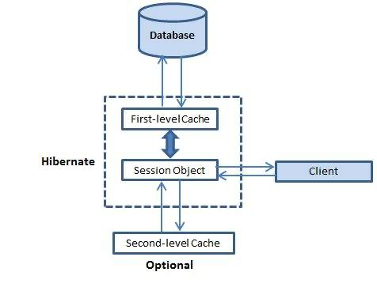

# Secondary Caches

Hibernate's secondary cache is a powerful tool that can greatly improve the performance of your application. By storing frequently accessed data in memory, the secondary cache can reduce the number of database queries that need to be made, resulting in faster response times and more efficient use of system resources. Whether you're working on a small project or a large enterprise application, the secondary cache is an essential part of any Hibernate-based system. So if you want to get the most out of your Hibernate application, take advantage of this powerful caching feature! &#x20;

<figure><figcaption></figcaption></figure>

Please see the [caching section](../../usage/caching.md) for all the wonderful caching strategies you can do with Hibernate.

## Configuration

A secondary cache provider is a class that manages a level of caching secondary to Hibernate's main caching context - the Hibernate session. A secondary cache enables longer-running cache contexts, more fine-grained control over cache busting, and other performance-related benefits.

The only setting necessary to enable secondary caching is the `secondaryCacheEnabled` setting:

```js
this.ormSettings = {
    secondaryCacheEnabled : true
};
```

Each cache region is backed by a BoxLang cache. `cacheProvider` picks the BoxLang cache provider, and `cacheConfig` can hold the properties of those caches as a struct:

```js
this.ormSettings = {
    secondaryCacheEnabled : true,
    cacheProvider         : "myProvider",
    cacheConfig           : { maxObjects : 5000, evictionPolicy : "LRU" }
};
```

The struct is used when `cacheProvider` names a registered BoxLang cache provider. With the default provider, the caches use BoxLang's default cache settings.


`cacheConfig` also accepts a file path, for compatibility. The path is passed to the cache provider, but the file is not read. EHCache XML files (`ehcache.xml`) have no effect in bx-orm 2.0.


## How the Cache Provider Setting Works

bx-orm bridges Hibernate's JCache (JSR-107) SPI to BoxLang's own `CacheService`, so `cacheProvider` selects a **BoxLang cache provider by name** rather than a specific Hibernate/EHCache implementation:

```js
this.ormSettings = {
    secondaryCacheEnabled : true,
    // use the "userCache" provider registered in your CacheBox/CacheService config
    cacheProvider : "userCache"
};
```

- The default, `"BoxCacheProvider"`, uses BoxLang's built-in in-memory cache.
- `"ConcurrentHashMap"` and `"HashTable"` are legacy aliases kept for CFML/Lucee compatibility; both simply resolve to the default BoxLang cache provider.
- Any other value must be the name of a cache provider already registered with BoxLang's `CacheService` (e.g. via CacheBox).
- The provider is resolved the first time a cache region is used, not at startup. An unknown provider name raises an error at that point.

See the [Caching](../../usage/caching.md) page for entity-level cache strategies (`cacheUse`).
